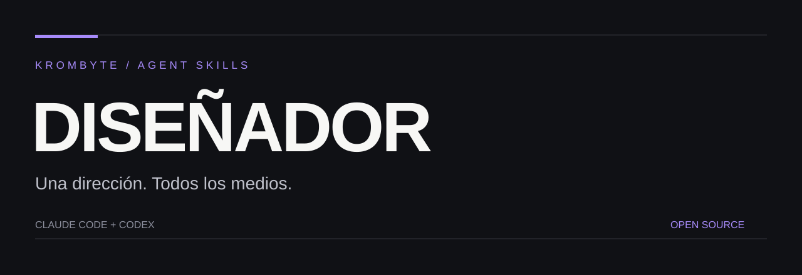

<p align="center"></p>

<p align="center"><strong>Estudio creativo con dirección visual, especialistas selectivos y control de calidad.</strong><br>Una skill portable, recursos bajo demanda y resultados verificables.</p>

<p align="center">Claude Code · Codex · Agent Skills · MIT</p>

## Qué hace

Reconoce · Define · Diseña · Produce · Valida.

## Instalar en Claude Code

En Claude Code:

```text
/plugin marketplace add AlexaDetalles/disenador-skill
/plugin install disenador@disenador-skills
```

Invocar la skill del plugin con `/disenador:disenador`. También puedes copiar solamente `skills/disenador/` a `~/.claude/skills/disenador/` para usar `/disenador` sin plugin.

## Instalar en Codex

Desde una carpeta de trabajo, clona el repositorio y copia la skill al directorio de skills personales. Ejemplo PowerShell:

```powershell
git clone https://github.com/AlexaDetalles/disenador-skill.git
New-Item -ItemType Directory -Force "$HOME/.agents/skills" | Out-Null
Copy-Item -Recurse "./disenador-skill/skills/disenador" "$HOME/.agents/skills/disenador"
```

Si ya existe una instalación, revísala o respáldala antes de reemplazarla. Usa `$disenador` en Codex. En versiones que utilicen otra carpeta de skills, copia el mismo directorio al destino configurado por tu instalación.

## Un ejemplo

```text
Rediseña esta landing con una dirección editorial sobria, implementa responsive y revisa teclado y legibilidad.
```

## Qué contiene

| Ruta | Propósito |
|---|---|
| `skills/disenador/SKILL.md` | Instrucciones portables |
| `skills/disenador/agents/openai.yaml` | Metadatos de Codex |
| `.claude-plugin/` | Plugin y catálogo para Claude Code |
| `LICENSE` y `NOTICE.md` | Condiciones y procedencia |
| `docs/` | Identidad visual del repositorio |

## Requisitos y límites

Los especialistas son guías Markdown cargadas a demanda. Python, Node, Blender y conectores de diseño solo se necesitan para los trabajos que los utilicen; no se instalan automáticamente.

La compatibilidad estructural se comprueba localmente; la carga real debe verificarse en cada cliente. No se promete acceso a herramientas ausentes, ahorro medido de tokens ni resultados infalibles.

## Contribuir

Consulta [CONTRIBUTING.md](CONTRIBUTING.md). Para información sensible, consulta [SECURITY.md](SECURITY.md).

## Licencia y créditos

MIT para las aportaciones originales de Isaac / KROMBYTE. Consulta [NOTICE.md](NOTICE.md) para procedencia y condiciones de material externo. Proyecto independiente, sin afiliación con Anthropic u OpenAI.
